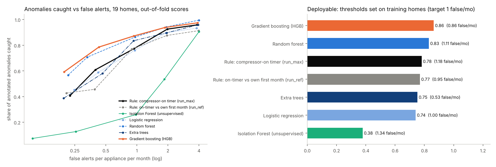
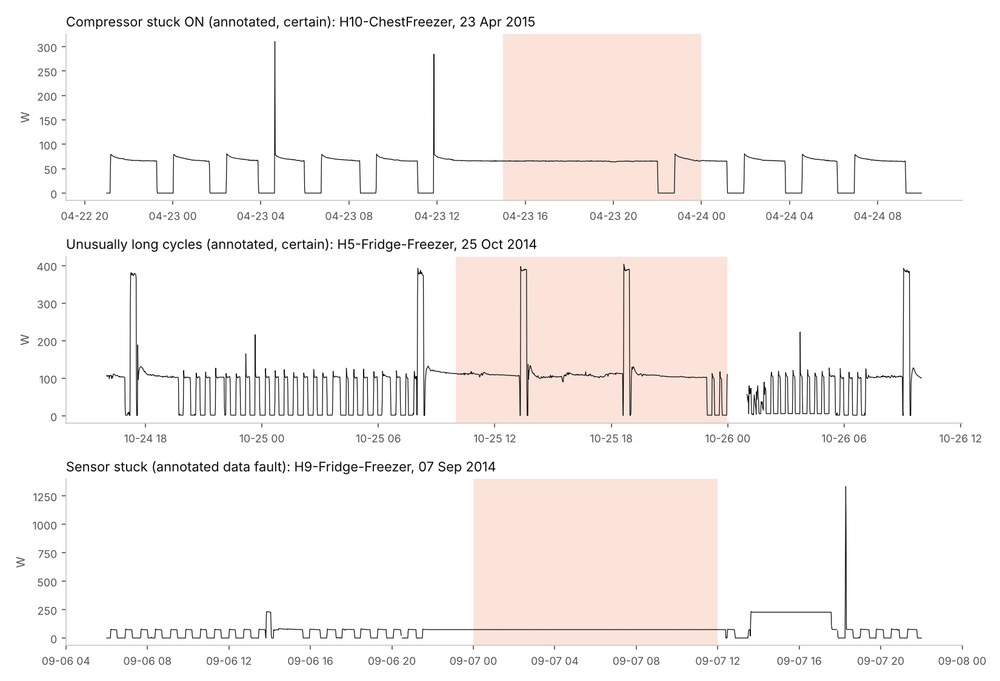
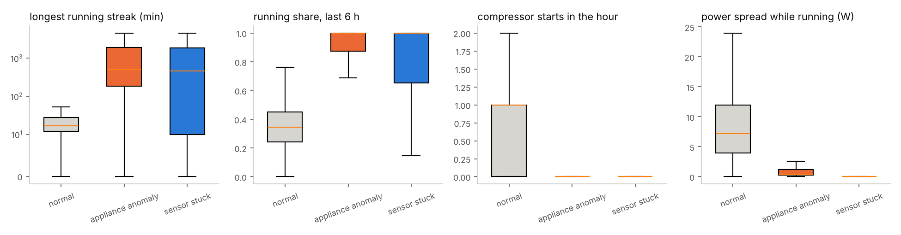
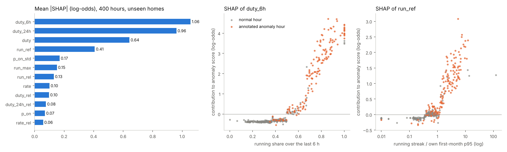

# Smart-home appliance anomaly detection from IoT plug sensors

> 📓 **Walkthrough notebook:** [`notebooks/walkthrough.ipynb`](notebooks/walkthrough.ipynb) tells the full analysis story step by step, with every table and chart already shown: data quality and outage audit, label-clock check, EDA, detectors on unseen homes, hypothesis tests, SHAP and business impact.

I built an anomaly detector for how smart-home appliances are functioning: it watches the smart-plug power sensor on
each appliance and alerts when the appliance stops behaving normally, so a household can act before damage is done.
It is validated on fridges and freezers, where the labelled data is (94% of the annotated anomalies): abnormal
functioning there means a compressor stuck on or cycling far longer than usual, and the risk is warm food or a failed
unit. It is trained and tested on **real, researcher-annotated anomalies in 19 UK homes**, and every result comes from
**homes the model never saw**. Because labelled anomalies exist, I compared rules, an unsupervised detector
(Isolation Forest) and supervised models; the best is supervised anomaly detection.

**Result.** At a false-alarm budget of about one false alert per appliance per month, the gradient-boosting detector
caught **86% of annotated anomalies (210 of 243) with 0.86 false alerts per appliance-month**. A one-line "compressor has
been running too long" rule caught **78% (190 of 243) at 1.18 false alerts**. At an identical false-alert rate the gap
is 87% vs 77% (95% CIs over homes 0.78-0.94 vs 0.64-0.88), and the model alerts earlier (median 2.2 h vs 3.0 h after
the anomaly starts). Across homes the recall gain is **not statistically significant** (Holm-adjusted p = 0.07, 18 homes),
so the evidence is: the model is at least as good as the rule, alerts sooner, and generalises to new homes; the rule
is a strong baseline that any model has to beat.

| | |
|---|---|
| Data | REFIT: 20 homes, 2013-2015, 129 million readings (one every ~7 s), whole-house + 9 plug sensors per home |
| Labels | 337 researcher-annotated anomalies (Rashid et al., ICASSP 2019); 94% on fridges and freezers |
| Scope | 32 fridges / freezers / fridge-freezers in 19 homes, 347,656 scored appliance-hours, 243 anomalies |
| Validation | leave-houses-out (5 folds), thresholds fixed on training homes, event-level scoring |
| Best detector | gradient boosting on hourly compressor behaviour relative to each appliance's own history |
| Explainability | exact TreeSHAP (checked against the `shap` package in CI) |



## 1. The decision and how it is measured

An alert is useful only if the household trusts it, so the design target is **anomalies caught at a fixed false-alarm
budget**, not accuracy:

* **Unit:** one appliance-hour. At the end of every hour, using only data up to that moment, each appliance gets a score.
* **Alerts:** alert hours of one appliance less than 3 h apart merge into one alert. An alert **catches** an anomaly if it
  overlaps the annotated span ± 2 h. An alert touching neither an anomaly nor a frozen-sensor event is a **false alert**.
* **Threshold:** chosen on the training homes as the lowest score with ≤ 1 false alert per appliance-month. Supervised
  models get honest training-home scores from an inner 3-fold leave-houses-out loop.
* **Metrics:** event recall, false alerts per appliance-month, delay to alert. Hour-level PR-AUC is reported but is not the
  decision metric: it weights one 2,288-hour anomaly as much as 2,288 one-hour anomalies.

## 2. Data and data quality

| Check | Finding | Action |
|---|---|---|
| Coverage | 88% of minutes have readings on average (lowest home 75%) | gaps kept as missing; hours with < 50% coverage not scored |
| Impossible values | 44,149 appliance readings above 4,000 W (values like 65535, 98301: corrupted bit patterns) | set to missing, the rule REFIT's own cleaned release uses |
| Duplicate timestamps | 4.0 M exact repeats of a second | last reading kept |
| Label mapping | annotations name appliances ("Freezer_2", "Fridge_garag"); the data numbers columns | explicit map from the REFIT readme, every name must map (`labels.py`) |
| Label clock | shifting every summer "continuous ON" event by ±3 h, the compressor edges are sharpest at **0 h**, not −1 h (UK summer time) | labels are UTC, the same clock as the data ([figure](reports/figures/label_alignment.png)) |
| Label errors | 2 events end before they start, 1 exact duplicate | dropped |
| Shared "stuck" window | 1-2 Aug 2014 is annotated "sensor stuck" in **11 homes at once**; in every one the reporting rate fell from ~13 to ~1 reading per minute | a data-collection outage, not 11 broken fridges: kept as a data fault, out of the appliance-anomaly task |
| Label completeness | of 8,947 hours with a 4 h+ running streak, 65% are annotated; one fridge-freezer (House 21) has 1,834 unannotated ones | false-alert rates are upper bounds, precision a lower bound |

## 3. What normal and anomalous look like



* A healthy compressor cycles: median longest run 17 minutes per hour (99th percentile 213 min); fridges run 23% of the
  time, freezers 39%. Compressors work harder in summer (median running share 0.43 vs 0.28 in winter, 29 of 32 appliances).
* A stuck-on compressor and a **frozen sensor** both read "running non-stop". The physics separates them: a real
  compressor's power drifts (median spread 1.1 W while running), a frozen reading repeats one value (0.0 W).



## 4. Features (all past-only)

For each appliance-hour, from the 1-minute series:

* **behaviour:** running share, compressor starts, longest running streak reaching into the hour (it keeps growing while a
  compressor is stuck), power level and spread while running, share of unchanged readings, data coverage and rate
* **recent:** running share over the last 6 and 24 hours
* **relative to the same appliance's past two weeks** (rolling, shifted so the current hour is never in its own baseline)
* **relative to the appliance's first month** (`run_ref`): a frozen reference later anomalies cannot contaminate; the first
  month is never scored

A unit test overwrites the future of a series and checks that no earlier feature changes.

**Deliberately excluded: hour of day and day of year.** Most annotations fall in 2014 across all homes, so calendar
features let a model learn *when annotators were busy*. Adding them back lowered out-of-fold recall (86.4% → 83.5%).

## 5. Results

**Deployable** (thresholds set on training homes, target ≤ 1 false alert per appliance-month):

| Detector | Anomalies caught | False alerts / appliance-month | Median delay | Alerts on frozen sensors |
|---|---|---|---|---|
| **Gradient boosting (HGB)** | **210 / 243 (86.4%)** | **0.86** | 2.5 h | 17 |
| Random forest | 202 / 243 (83.1%) | 1.11 | 2.0 h | 22 |
| Rule: compressor-on timer | 190 / 243 (78.2%) | 1.18 | 3.0 h | 15 |
| Rule: timer vs own first month | 187 / 243 (77.0%) | 0.95 | 2.0 h | 29 |
| Extra trees | 183 / 243 (75.3%) | 0.53 | 3.0 h | 14 |
| Logistic regression | 180 / 243 (74.1%) | 1.00 | 3.0 h | 19 |
| Isolation Forest (unsupervised) | 92 / 243 (37.9%) | 1.34 | 4.0 h | 37 |

By kind of anomaly, HGB caught 90% of "stuck on" anomalies (152/169), 84% of "long cycles" (51/61) and 54% of the 13 "abnormal signature" anomalies.

**Matched false-alert rate** (every detector's out-of-fold scores thresholded to the same rate, so recalls are directly
comparable): HGB 87.2% (95% CI over homes 0.78-0.94), random forest 86.4%, timer rule 77.4% (0.64-0.88), Isolation
Forest 25.9%.

**A quieter budget.** One false alert per appliance per month is a lot for a household. At the tightest budget tested,
HGB caught 47% of anomalies with 0.13 false alerts per appliance-month (about 1.6 a year); the timer caught 51% but with
0.43 (about 5 a year). The budget is a product decision; the curve on the left of the figure above is the menu.

**Ablation** (same HGB, same folds, matched rate of 1 per appliance-month):

| Features | Anomalies caught |
|---|---|
| raw behaviour only | 72.4% |
| raw + recent running share | 81.5% |
| relative-to-own-history only | 61.3% |
| **all (used)** | **87.2%** |
| all + calendar (rejected) | 85.2% |

Neither the raw nor the relative view is enough alone; together they generalise to new homes.

## 6. Hypothesis tests (Holm-corrected; the unit is the home, because anomalies within a home are not independent)

| # | Claim | Result | p (Holm) |
|---|---|---|---|
| H1 | HGB catches a larger share of anomalies per home than the timer rule (same false-alert rate) | better in 9 homes, worse in 3, median gain +1.4 pts; **not supported** | 0.075 |
| H2 | HGB alerts earlier on anomalies both detect | median 2.2 h vs 3.0 h; earlier on 100 anomalies, later on 46; **supported** | 0.0001 |
| H3 | Adding relative-to-own-history and recent features raises per-home recall over raw behaviour only | median +17 pts per home; **supported** | 0.0014 |
| H4 | Frozen sensors show less power variation while "running" than real stuck-on compressors | 0.0 W vs 1.1 W, Cliff's δ = −0.95; **supported** | < 0.0001 |
| H5 | Compressors run more in summer than in winter | 0.43 vs 0.28, 29 of 32 appliances; **supported** | < 0.0001 |

H1 is the honest headline: pooled over all anomalies the model catches ~10 points more, but most homes have only 1-10
anomalies, so a per-home test cannot confirm it. More homes, not a bigger model, is what would settle it.

## 7. Frozen sensors are a separate problem

A rule "reading unchanged for ≥ 90% of running minutes while running ≥ 90% of the hour" caught 59 of 65 frozen-sensor
events (event-level AUC of the unchanged-reading share: 0.98). It also fires on 26 annotated appliance anomalies, so it is a
**triage signal** ("check the sensor before sending anyone"), not a filter that silently drops alerts.

## 8. Explainability



Exact TreeSHAP on 400 hours from homes outside training. The model mostly reasons like an engineer: a running share near
100% over the last 6 and 24 hours, and a running streak many times the appliance's own first-month norm, push the score
up; a normal streak pushes it down. SHAP values add up to the model output to within 1e-14.

## 9. Business impact

* **Electricity is not the point.** A typical anomaly wastes about 0.25 kWh (≈ £0.04 at an assumed £0.15/kWh); all 243
  anomalies together wasted about 198 kWh (≈ £30).
* **Unnoticed abnormal running time is.** The 243 anomalies add up to 5,958 hours of a fridge or freezer in an abnormal state. If a household
  reacts within 2 hours of an alert, the HGB detector would have cut about 80% of those hours (the timer rule about 81%,
  because the hours are dominated by a few very long anomalies both catch).
* **Where the model earns its place:** more anomalies caught at the same or lower false-alarm rate, earlier alerts, and a
  separate frozen-sensor signal so a platform does not send a technician to a healthy fridge.

**Recommendation.** Ship the gradient-boosting detector with the threshold set from the budget the product can tolerate,
route alerts that look like frozen sensors to a "check the sensor" message, and keep the on-timer rule as the
fallback for appliances in their first month. Re-test H1 when more annotated homes are available.

## 10. Limitations

* Annotations are incomplete and one research team's judgement; "false" alerts include some real, unannotated anomalies.
* 19 homes in one UK region, 2013-2015; appliances and climate elsewhere may differ.
* Validated only on cold appliances; other appliances (washing machines, dishwashers, microwaves) have 1-6 annotations each, too few to evaluate. The same approach (each appliance against its own normal behaviour) would need labels for them before it could be claimed.
* Excess energy uses the appliance's previous 30 days as "normal"; the cost of spoiled food is not in the data.
* Short anomalies are the hardest: HGB caught 68% of anomalies lasting up to 4 hours vs 90-100% of longer ones; half of the 33 missed anomalies are under 4 hours.

## How this project started

My first version of this project used a single-house Kaggle dataset without anomaly labels. It is kept unchanged in
[`notebooks/original/`](notebooks/original/) with an [audit](docs/original_project_audit.md) of what it got right and
what made its conclusions unreliable (a 5-hour timestamp shift, a target predicted from its own components, kW-minutes
reported as kWh, and anomalies that were really incomplete periods). The lack of real anomaly labels is why this rebuild
moved to REFIT.

## Repository

```
scripts/ingest_refit.py         8-second CSVs -> 1-minute files per house (impossible values removed)
src/smart_energy/labels.py      annotation loading, appliance -> sensor-column map, UK time helpers
src/smart_energy/features.py    appliance-hour features with past-only baselines
src/smart_energy/data.py        appliance-hour table with labels
src/smart_energy/detect.py      rules, unsupervised and supervised detectors, alert merging, event scoring, budget thresholds
src/smart_energy/experiments.py all stages: quality, eda, detect, ablation, matched, stuck, hypotheses, explain, business
results/                        every number above (JSON / CSV)
reports/figures/                every figure above
notebooks/walkthrough.ipynb     the results, step by step (no raw data needed)
tests/                          features, leakage, label mapping, time zones, event scoring, TreeSHAP (synthetic data)
```

## Reproduce

```bash
pip install -e ".[dev]"
# download the data as described in data/README.md, then:
python scripts/ingest_refit.py data/raw/refit data/interim      # ~2 min
python -m smart_energy.experiments                               # ~50 min on 2 CPU cores
pytest -q
```

## Data and citation

REFIT data and anomaly annotations: University of Strathclyde, CC BY 4.0.
D. Murray et al., "An electrical load measurements dataset of United Kingdom households from a two-year longitudinal
study", *Scientific Data* 4, 160122 (2017). H. Rashid, V. Stankovic, L. Stankovic, P. Singh, "Evaluation of
Non-Intrusive Load Monitoring Algorithms for Appliance-level Anomaly Detection", ICASSP 2019.
